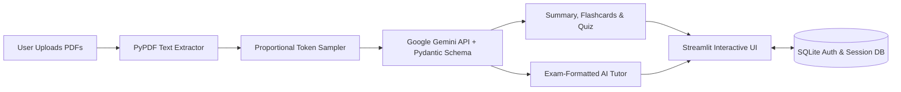

# 📚 SmartStudy AI — Intelligent University Exam & Study Assistant

[](https://smart-study-ai-5zn4zkkdlkh43z8vvepfha.streamlit.app/)
[](https://python.org)
[](https://google.com)

**SmartStudy AI** is a full-stack AI-powered academic assistant built as a **B.Tech Computer Science & Engineering (CSE) Mini Project**. It transforms lecture PDFs, textbooks, and previous-year question papers into structured revision kits and exam-formatted answers.

---

## ✨ Key Features

- **Multi-PDF Proportional Token Sampling:** Upload up to **5 PDFs (500 MB per file)** simultaneously. The engine proportionally samples across all uploaded documents to stay within safe LLM token limits without ignoring later chapters.
- **Structured AI Study Kit Generation:** Uses **Pydantic JSON Schemas** with Google Gemini to reliably generate:
  - 📌 **5-Bullet Key Concept Summary**
  - 💡 **6 Interactive Q&A Flashcards**
  - ❓ **5-Question Practice Quiz** with difficulty levels (*Easy / Medium / Hard*), instant scoring, and detailed explanations.
- **University Exam-Formatted AI Tutor:** Context-grounded chatbot that answers doubts strictly from uploaded notes in **2-Mark**, **5-Mark**, **10-Mark Essay**, or **Simple (EL5)** formats.
- **One-Click Question Paper Solver:** Upload lecture notes alongside a question bank PDF and solve all listed questions in one click.
- **User Authentication & Study History:** Built-in **SQLite** database with salted password hashing (`hashlib`) to save and reload past study sessions and chat histories anytime.
- **Modern Dual-Theme UI:** Responsive Light & Dark mode switcher, one-click built-in OS/Deadlocks demo notes, and offline `.txt` Study Kit export.

---

## 🏗️ System Architecture



---

## 🛠️ Tech Stack

- **Frontend & Web Framework:** Streamlit (Python)
- **LLM & Structured Outputs:** Google GenAI SDK (`gemini-2.5-flash` / `gemini-3.5-flash`) + Pydantic
- **Document Processing:** `pypdf`
- **Database & Security:** SQLite3 + Salted SHA-256 Password Hashing
- **Deployment:** Streamlit Community Cloud

---

## 🚀 Run Locally

1. **Clone the repository:**
   ```bash
   git clone https://github.com
   cd smart-study-ai
   ```
2. **Create and activate a virtual environment:**
   ```bash
   python -m venv .venv
   .\.venv\Scripts\Activate.ps1
   ```
3. **Install dependencies:**
   ```bash
   pip install -r requirements.txt
   ```
4. **Configure your API key:**
   Create a `.env` file in the root directory and add:
   ```env
   GEMINI_API_KEY=your_google_ai_studio_api_key
   ```
5. **Launch the application:**
   ```bash
   streamlit run app.py
   ```
